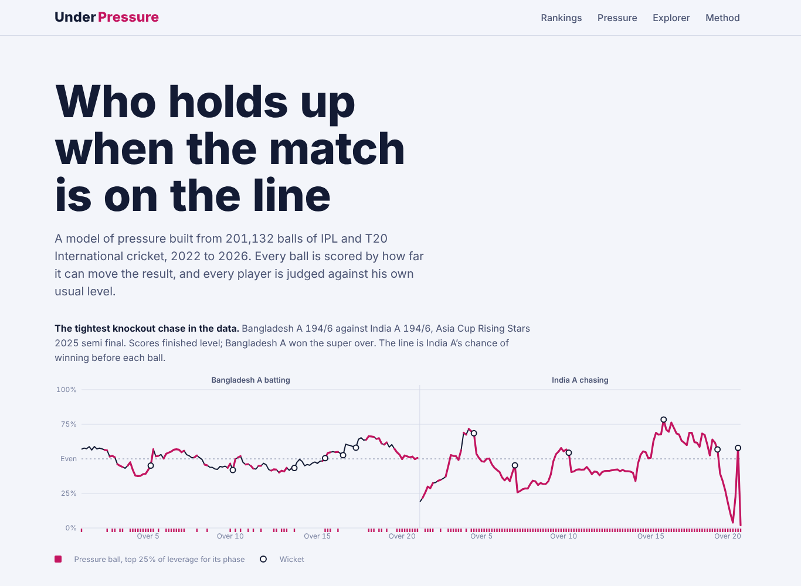

# Under Pressure

Which T20 batters and bowlers hold up when the match is on the line? This repository ranks them from 201,132 balls of IPL and T20 International cricket (2022 to 2026), and ships an interactive dashboard that shows the evidence behind every pick.

Built for **SupeRR Selector Season 2, Round 1** (Rajasthan Royals).

**Live dashboard:** `https://under-pressure-kw5o.onrender.com` 



## The submitted top 10

| Rank | Batter | Bowler |
| --- | --- | --- |
| 1 | Vaibhav Sooryavanshi | Jasprit Bumrah |
| 2 | Tim David | Josh Hazlewood |
| 3 | Heinrich Klaasen | Sunil Narine |
| 4 | Tilak Varma | Rashid Khan |
| 5 | Abhishek Sharma | Nathan Ellis |
| 6 | Pathum Nissanka | Varun Chakravarthy |
| 7 | Shashank Singh | Bhuvneshwar Kumar |
| 8 | Shai Hope | Mohsin Khan |
| 9 | Jos Buttler | Mujeeb Ur Rahman |
| 10 | Finn Allen | Axar Patel |

Jos Buttler at 9 is a selector's call. The model ranks him 11th (rating 0.80), 0.05 behind Priyansh Arya at 9th. That gap is inside the uncertainty for batting ranks 6 to 10, and Buttler's pressure sample is about four times larger (671 balls against 174). The override is written into `pipeline/build_dashboard_data.py`, so it is visible and reversible. The model's own list is in `outputs/model_top10.csv`.

## How pressure is defined

Pressure is **leverage**: the expected size of the win-probability swing a single ball can cause.

1. **Win probability.** A logistic model with interaction terms predicts the batting side's chance of winning before every ball, from runs, wickets, balls left, target, required rate, venue par and recent collapse. Out-of-fold Brier score 0.1755, against 0.1823 for gradient boosting.
2. **Outcome odds.** A gradient-boosted classifier gives the probability of each outcome (0, 1, 2, 3, 4, 6, wicket, wide, no-ball) in that state.
3. **Leverage.** For each ball, the sum over outcomes of probability times the win-probability swing it would cause.
4. **Pressure ball.** The top 25% of leverage within each phase (powerplay, overs 7-10, overs 11-15, death).

Leverage is validated against what actually happened: the average real swing per ball rises in every leverage decile, from 0.2% to 6.1% of a win.

## How players are rated

- Every ball is scored against what an average player would produce in the same state, against the same bowler type and batter hand.
- Each player's pressure score is anchored to his own usual level on ordinary balls. How strongly is chosen to best predict held-out pressure performance.
- Components that repeat on held-out matches are weighted by how well they repeat. Rise versus usual level (15%) and consistency across matches (10%) are fixed because the brief names both.

| Batting component | Weight | Bowling component | Weight |
| --- | --- | --- | --- |
| Runs above expected | 27% | Run value (runs saved + wickets) | 55% |
| Wicket preservation | 28% | Discipline (wides, no-balls) | 12% |
| Dot-ball avoidance in steep chases | 13% | Overs 7-10 control | 8% |
| Rebuilding after a collapse | 7% | Rise vs own usual level | 15% |
| Rise vs own usual level | 15% | Consistency across matches | 10% |
| Consistency across matches | 10% | | |

Eligibility: 60 pressure balls in at least 12 matches for batters, 20 matches for bowlers. That leaves 164 batters and 113 bowlers. Knockout balls carry 2.0x weight and away T20I balls 1.25x.

Full reasoning, tests and limitations are in the methodology report.

## Repository layout

```
.
├── site/                         The dashboard: deploy this folder as-is
│   ├── index.html
│   ├── styles.css
│   ├── app.js                    No framework; every chart is hand-built SVG
│   └── data/dashboard.json       Everything the dashboard shows
├── pipeline/
│   ├── pressure_v2.py            Step 1: features, win-probability and outcome models, leverage
│   ├── rating_v2.py              Step 2: player ratings, tests, bootstrap, sensitivity checks
│   └── build_dashboard_data.py   Step 3: selector overrides and the dashboard's JSON
├── outputs/                      Results written by the pipeline
│   ├── model_top10.csv           The model's own top 10 lists
│   ├── submitted_top10.csv       The submitted lists, with the selector's note
│   ├── batters_pressure_v2.csv   All 164 eligible batters, every component
│   ├── bowlers_pressure_v2.csv   All 113 eligible bowlers, every component
│   └── sensitivity_*.csv         How the top 10 changes when one choice changes
├── data/raw/                     Put the six supplied CSVs here (not committed)
├── docs/                         Screenshots and the methodology report
├── render.yaml                   One-click Render deployment
└── requirements.txt
```

## Run the dashboard locally

The page loads its data with `fetch`, so it needs to be served over HTTP rather than opened as a file.

```bash
cd site
python -m http.server 8000
```

Then open <http://localhost:8000>.

## Rebuild the rankings from the raw data

```bash
python -m venv .venv
source .venv/bin/activate          # Windows: .venv\Scripts\activate
pip install -r requirements.txt

# copy the six supplied CSVs into data/raw/ first
python pipeline/pressure_v2.py           # a few minutes: fits the models, writes outputs/balls_v2.pkl
python pipeline/rating_v2.py             # 10-20 minutes: ratings, bootstrap, sensitivity
python pipeline/build_dashboard_data.py  # about a minute: writes site/data/dashboard.json
```

Run all three from the repository root. Paths can be changed with environment variables:

| Variable | Default | Used for |
| --- | --- | --- |
| `SUPERR_DATA` | `data/raw/` | The six supplied CSVs |
| `SUPERR_OUT` | `outputs/` | Pipeline results and the intermediate ball table |
| `SUPERR_SITE` | `site/data/` | Where the dashboard JSON is written |

`outputs/balls_v2.pkl` is about 115 MB, over GitHub's 100 MB file limit, so it is git-ignored and rebuilt by step 1. All randomness uses seed 7.

## Push to GitHub

With the GitHub CLI:

```bash
git init
git add .
git commit -m "Under Pressure: rankings, pipeline and dashboard"
gh repo create superr-pressure --public --source=. --push
```

Without it, create an empty repository named `superr-pressure` on github.com (no README or licence, so the first push is clean), then:

```bash
git init
git add .
git commit -m "Under Pressure: rankings, pipeline and dashboard"
git branch -M main
git remote add origin https://github.com/YOUR-USERNAME/superr-pressure.git
git push -u origin main
```

## Limits worth knowing

- Batting ranks 6 to 10 are close calls. Each of those players makes the top 10 in only about a quarter to a third of resampled datasets.
- Rising under pressure is a small effect. A player's usual level explains most of his pressure performance.
- The data has no line, length, field placings or usable ball speed.
- Leaving out the 2026 season keeps only five of the model's top ten batters.

## Data

The ball-by-ball and supporting files were supplied for SupeRR Selector Season 2 and are not redistributed here.
